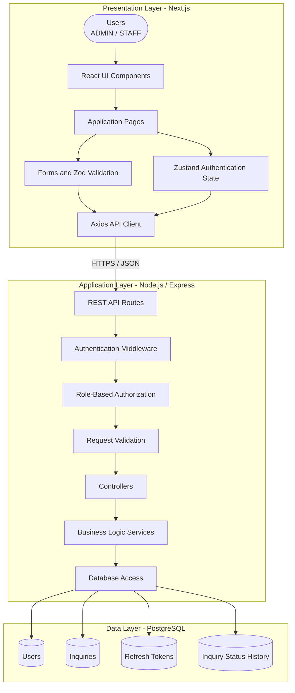
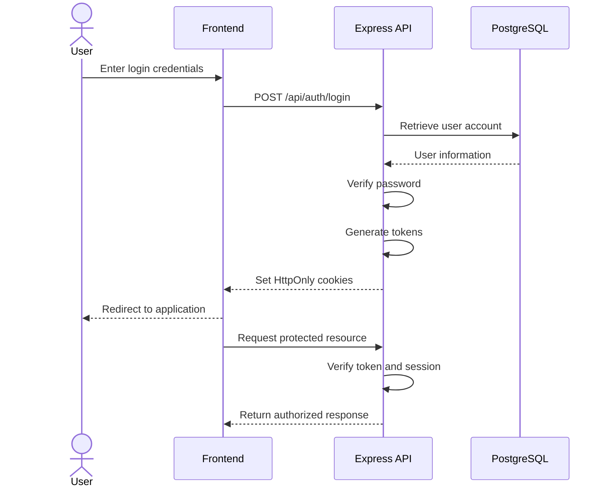
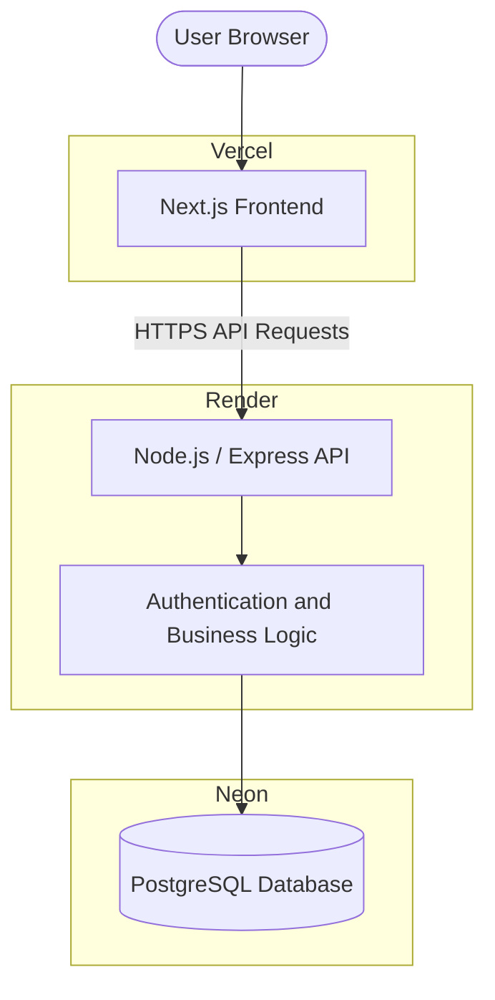
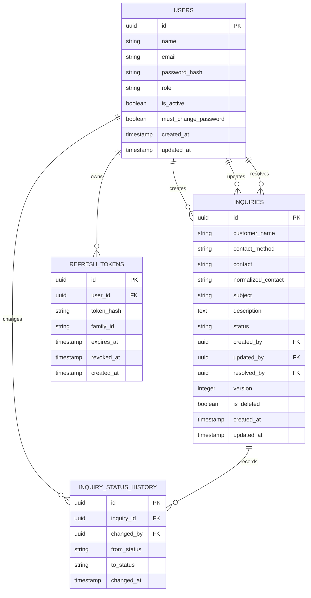
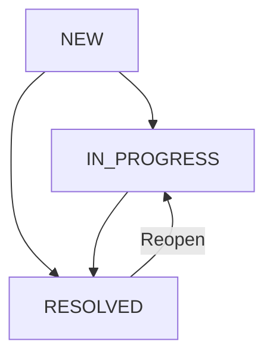

# Customer Inquiry Management System

A full-stack web application for managing customer inquiries, support workflows, and staff operations.

[Live Application](https://customer-inquiry-management-system-alpha.vercel.app/) · [API Documentation](https://customer-inquiry-management-system-mqze.onrender.com/api-docs) · [Database ER Diagram](docs/ERD.md) · [Design Decisions](DECISIONS.md)

    

---

## Overview

The Customer Inquiry Management System provides a centralized workspace where customer service teams can record, track, and manage customer inquiries.

The application includes secure authentication, role-based access control, inquiry lifecycle management, duplicate detection, staff administration, and audit history.

It is built with a separate frontend and backend architecture, using PostgreSQL for persistent data storage.

## Features

### Authentication and Security
- Secure user authentication.
- JWT-based access authentication.
- HttpOnly cookie-based token storage.
- Refresh token rotation and session management.
- Password hashing using bcrypt.
- Protected frontend routes.
- Backend-enforced authentication and authorization.
- Forced password change support.
- Session invalidation for deactivated users.

### Inquiry Management
- Create and manage customer inquiries.
- View detailed inquiry information.
- Search and filter inquiries.
- Paginated inquiry listing.
- Update inquiry statuses.
- Reopen resolved inquiries.
- Potential duplicate inquiry detection.
- Duplicate confirmation workflow.
- Inquiry status history.
- Soft deletion with administrator authorization.
- Optimistic concurrency control to prevent stale updates.

### Staff Management
- ADMIN and STAFF roles.
- Create and update staff accounts.
- Activate and deactivate staff accounts.
- Reset staff passwords.
- Administrator-only staff management.
- Session revocation when staff accounts are deactivated or passwords are reset.

### Data Integrity
- Frontend and backend validation.
- Controlled inquiry status transitions.
- Normalized contact information for duplicate detection.
- HTTP 409 conflict responses for conflicting or outdated operations.
- Audit information for important inquiry actions.
- Parameterized database queries.

## Technology Stack

| Category | Technologies |
|---|---|
| Frontend Framework | Next.js |
| UI Library | React |
| Programming Language | TypeScript |
| Styling | Tailwind CSS |
| State Management | Zustand |
| HTTP Client | Axios |
| Form Management | React Hook Form |
| Form Validation | Zod |
| Icons | Lucide React |
| Backend Runtime | Node.js |
| Backend Framework | Express.js |
| Database | PostgreSQL |
| Authentication | JWT, HttpOnly Cookies |
| Password Hashing | bcrypt |
| API Documentation | Swagger / OpenAPI |
| Frontend Testing | Vitest, React Testing Library |
| Backend Testing | Vitest, Supertest |
| Frontend Hosting | Vercel |
| Backend Hosting | Render |
| Database Hosting | Neon |
| Version Control | Git and GitHub |

---

## High-Level Architecture

The application follows a three-tier architecture consisting of the presentation layer, application layer, and data layer.

The frontend handles user interactions and communicates with the backend through HTTPS requests. The backend manages authentication, authorization, request validation, business logic, and database operations.

### Architecture Diagram



### Main Components

| Component | Responsibility |
|---|---|
| Next.js Frontend | Provides the user interface and application navigation. |
| React Components | Render reusable interface elements and pages. |
| React Hook Form and Zod | Manage form state and frontend validation. |
| Zustand | Maintains authentication-related frontend state. |
| Axios | Handles communication with the backend API. |
| Express REST API | Exposes endpoints for authentication, inquiries, and staff management. |
| Authentication Middleware | Verifies authentication and user sessions. |
| Authorization Middleware | Enforces ADMIN and STAFF permissions. |
| Validation Layer | Validates incoming API requests. |
| Controllers | Handle API requests and responses. |
| Business Logic Services | Implement inquiry workflows, duplicate detection, and status transitions. |
| Database Access | Handles PostgreSQL operations. |
| PostgreSQL | Persists users, inquiries, refresh tokens, and status history. |

### Authentication Flow



### Deployment Architecture

The frontend, backend, and database are deployed as separate services.



| Component | Platform |
|---|---|
| Frontend | Vercel |
| Backend API | Render |
| Database | Neon PostgreSQL |

---

## Database Design

PostgreSQL is used to store user accounts, customer inquiries, authentication sessions, and inquiry status history.

### Entity Relationship Diagram



**Note:** This is a conceptual diagram of the main entities. Refer to the SQL migration files for exact column definitions, constraints, indexes, and foreign-key rules.

### Entity Responsibilities

| Entity | Responsibility |
|---|---|
| `users` | Stores administrator and staff account information. |
| `inquiries` | Stores customer inquiry details, status, audit references, and deletion state. |
| `refresh_tokens` | Stores hashed refresh tokens and session lifecycle information. |
| `inquiry_status_history` | Records inquiry status changes and the user responsible for each change. |

For the standalone diagram, see [docs/ERD.md](docs/ERD.md).

---

## User Roles and Permissions

The system supports two user roles.

| Feature | ADMIN | STAFF |
|---|:---:|:---:|
| Sign in | ✓ | ✓ |
| View inquiries | ✓ | ✓ |
| Create inquiries | ✓ | ✓ |
| Search and filter inquiries | ✓ | ✓ |
| View inquiry details | ✓ | ✓ |
| Update inquiry status | ✓ | ✓ |
| View inquiry history | ✓ | ✓ |
| Soft-delete inquiries | ✓ | — |
| View staff directory | ✓ | — |
| Create and update staff | ✓ | — |
| Activate and deactivate staff | ✓ | — |
| Reset staff passwords | ✓ | — |

All permissions are enforced by the backend. Frontend route protection is not treated as a security boundary.

## Inquiry Lifecycle

The application uses three inquiry statuses.

| Status | Description |
|---|---|
| `NEW` | Newly recorded inquiry. |
| `IN_PROGRESS` | Inquiry currently being handled. |
| `RESOLVED` | Inquiry that has been resolved. |

### Allowed Status Transitions



Invalid status transitions are rejected by the backend.

---

## Security and Data Integrity

### Authentication

- Access tokens are stored in HttpOnly cookies.
- Refresh tokens are rotated.
- Refresh token hashes are stored in PostgreSQL.
- Passwords are hashed using bcrypt.
- Protected API endpoints require authentication.
- Staff management and inquiry deletion require administrator authorization.

### Duplicate Detection

Potential duplicates are identified using normalized contact information.

When a potential duplicate is detected:

1. The application displays matching active inquiries.
2. The user can review the matching records.
3. The user can confirm whether the new inquiry represents a separate issue.
4. The backend independently checks the duplicate condition before creating the inquiry.

### Optimistic Concurrency

The inquiry version field helps detect outdated updates.

When an update is made using an old version, the backend returns HTTP `409 Conflict` rather than silently overwriting a more recent change.

### Soft Deletion

Inquiries are soft-deleted instead of being permanently removed. This preserves historical records and audit information.

---

## Project Structure

```text
customer-inquiry-management-system/
│
├── backend/
│   ├── src/
│   │   ├── config/
│   │   ├── controllers/
│   │   ├── db/
│   │   ├── middleware/
│   │   ├── routes/
│   │   ├── services/
│   │   ├── types/
│   │   ├── utils/
│   │   ├── validators/
│   │   ├── app.ts
│   │   └── server.ts
│   ├── migrations/
│   ├── tests/
│   ├── .env.example
│   ├── package.json
│   └── TESTING.md
│
├── frontend/
│   ├── src/
│   │   ├── app/
│   │   ├── components/
│   │   ├── features/
│   │   ├── hooks/
│   │   ├── lib/
│   │   ├── stores/
│   │   └── tests/
│   ├── public/
│   ├── package.json
│   └── vitest.config.ts
│
├── docs/
│   └── ERD.md
│
├── .github/
│   └── workflows/
│
├── .gitignore
├── LICENSE
├── README.md
├── DECISIONS.md
└── CONTRIBUTING.md
```

The directory tree provides a high-level overview. Actual files and folders may vary as the project develops.

---

## Getting Started

Follow these instructions to run the application locally.

### Prerequisites

Install the following:

- [Node.js](https://nodejs.org/)
- npm (included with Node.js)
- [Git](https://git-scm.com/)
- PostgreSQL database access
- VS Code or another code editor

### 1. Clone the Repository

Open PowerShell or a terminal:

```bash
git clone https://github.com/dinithanki/customer-inquiry-management-system.git

cd customer-inquiry-management-system
```

### 2. Configure the Backend

Navigate to the backend directory:

```powershell
cd backend
npm install
```

Create a `.env` file inside the `backend/` directory.

```env
PORT=5000

FRONTEND_ORIGIN=http://localhost:3000

DATABASE_URL=YOUR_DATABASE_URL
DATABASE_URL_TEST=YOUR_TEST_DATABASE_URL

INITIAL_ADMIN_NAME=System Administrator
INITIAL_ADMIN_EMAIL=admin@example.com
INITIAL_ADMIN_PASSWORD=YOUR_ADMIN_PASSWORD

JWT_ACCESS_SECRET=YOUR_LONG_RANDOM_SECRET
ACCESS_TOKEN_EXPIRES_IN=15m
REFRESH_TOKEN_EXPIRES_IN=7d
```

Replace the example values with your own configuration.

**Important:**

- `DATABASE_URL` is the normal application database connection.
- `DATABASE_URL_TEST` is the separate test database connection.
- Never commit your `.env` file.
- Never publish database passwords, JWT secrets, or administrator passwords.
- Keep your development database separate from production.

### 3. Select the Development/Test Database

The backend selects its database connection based on `NODE_ENV`.

| Environment | Database |
|---|---|
| `NODE_ENV=test` | `DATABASE_URL_TEST` |
| Other environments | `DATABASE_URL` |

For local development, select the test database.

In PowerShell, from the `backend/` directory:

```powershell
$env:NODE_ENV = "test"
```

Keep this terminal in test mode while running the migration, seed, and backend commands below.

### 4. Run Database Migrations

Make sure your test database is available and `DATABASE_URL_TEST` points to it.

```bash
npm run db:migrate
```

This applies the database migrations required by the application.

### 5. Create the Initial ADMIN Account

Make sure the following environment variables are configured in `backend/.env`:

```env
INITIAL_ADMIN_NAME=System Administrator
INITIAL_ADMIN_EMAIL=admin@example.com
INITIAL_ADMIN_PASSWORD=YOUR_ADMIN_PASSWORD
```

Run the administrator seed command:

```bash
npm run db:seed:admin
```

The seed script uses the configured administrator details to create the initial ADMIN account.

Use these credentials when signing in locally. Do not put your actual administrator password in this README or commit it to GitHub.

### 6. Start the Backend

Keep `NODE_ENV=test` in the same PowerShell terminal.

```bash
npm run dev
```

The backend should be available at:

- API: `http://localhost:5000`
- Swagger: `http://localhost:5000/api-docs`
- Health: `http://localhost:5000/api/health`

Keep this terminal running.

### 7. Configure the Frontend

Open a second terminal from the repository root:

```powershell
cd frontend
npm install
```

Create a `.env.local` file inside the `frontend/` directory:

```env
NEXT_PUBLIC_API_URL=http://localhost:5000/api
```

### 8. Start the Frontend

```bash
npm run dev
```

Open [http://localhost:3000](http://localhost:3000).

Sign in using the administrator email and password configured in the backend seed environment variables.

You can now use the application locally.

### Local Development Summary

You should have two running terminals.

| Terminal | Directory | Command |
|---|---|---|
| Terminal 1 | `backend/` | Set `NODE_ENV=test`, then run `npm run dev` |
| Terminal 2 | `frontend/` | Run `npm run dev` |

**Database safety:** Do not remove the `NODE_ENV=test` override before running local migrations or the seed command. The normal non-test mode selects `DATABASE_URL`, which may point to production.

---

## API Documentation

The backend provides REST API endpoints for authentication, staff management, and inquiry management.

### Swagger UI

- Local: `http://localhost:5000/api-docs`
- Production: [Open Swagger Documentation](https://customer-inquiry-management-system-mqze.onrender.com/api-docs)

### Main API Groups

| API Group | Description |
|---|---|
| `/api/auth` | Authentication and session management |
| `/api/users` | Staff and user management |
| `/api/inquiries` | Inquiry operations |
| `/api/health` | Backend health check |
| `/api/health/db` | Database connectivity check |

Use Swagger UI to explore the available endpoints, request parameters, responses, and authentication requirements.

---

## Testing

The project includes automated backend and frontend tests.

### Backend Tests

The backend test suite contains **86 automated tests across 12 test files**.

From `backend/`:

```bash
npm test
```

Run type checking:

```bash
npm run typecheck
```

Build the backend:

```bash
npm run build
```

### Frontend Tests

The frontend test suite contains **6 automated tests across 3 test files**.

From `frontend/`:

```bash
npm test
```

Run lint checks:

```bash
npm run lint
```

Run TypeScript checks:

```bash
npx tsc --noEmit
```

Build the frontend:

```bash
npm run build
```

### Testing Coverage

The test suites cover areas including:

- Authentication and authorization.
- Backend request validation.
- Inquiry business rules.
- API behavior.
- Authentication state management.
- Inquiry form validation.
- Inquiry form interactions.

See [backend/TESTING.md](backend/TESTING.md) for additional backend testing information.

Automated tests do not replace full manual verification of the deployed frontend, backend, and database working together.

---

## Deployment

The application is deployed using separate frontend and backend hosting services.

### Frontend - Vercel

| Setting | Value |
|---|---|
| Hosting Platform | Vercel |
| Root Directory | `frontend` |
| Framework | Next.js |

Production environment variable:

```env
NEXT_PUBLIC_API_URL=https://customer-inquiry-management-system-mqze.onrender.com/api
```

### Backend - Render

| Setting | Value |
|---|---|
| Hosting Platform | Render |
| Root Directory | `backend` |
| Build Command | `npm install && npm run build` |
| Start Command | `npm start` |

Configure the required production environment variables in Render:

```env
NODE_ENV=production
DATABASE_URL=YOUR_PRODUCTION_DATABASE_URL
JWT_ACCESS_SECRET=YOUR_LONG_RANDOM_SECRET
FRONTEND_ORIGIN=https://customer-inquiry-management-system-alpha.vercel.app
BACKEND_URL=https://customer-inquiry-management-system-mqze.onrender.com
```

Also configure the initial administrator variables when required by the seed process.

Render supplies the `PORT` environment variable.

Before serving production traffic, ensure that migrations have been applied to the production database and the initial administrator account exists.

Never use your test database for production data.

---

## Additional Documentation

| Document | Description |
|---|---|
| [DECISIONS.md](DECISIONS.md) | Assumptions, design decisions, trade-offs, and future improvements |
| [docs/ERD.md](docs/ERD.md) | Database entity relationship diagram |
| [backend/TESTING.md](backend/TESTING.md) | Backend testing information |
| [CONTRIBUTING.md](CONTRIBUTING.md) | Contribution guidelines |
| [LICENSE](LICENSE) | Project license |

## Future Improvements

Potential future enhancements include:

- Real-time inquiry updates across multiple sessions.
- Expanded integration and end-to-end testing.
- Improved application logging and monitoring.
- Inquiry analytics and reporting.
- Further accessibility improvements.

## Contributing

Contributions, bug reports, and suggestions are welcome.

Please read the [Contributing Guide](CONTRIBUTING.md) before submitting changes.

## License

This project is licensed under the MIT License.

See the [LICENSE](LICENSE) file for the complete license text.

## Author

**Dinith Pamunuwatte**

- GitHub: [@dinithanki](https://github.com/dinithanki)
- Portfolio: [dinith-pamunuwatte.vercel.app](https://dinith-pamunuwatte.vercel.app/)

---

<p align="center">
  Built with Next.js, TypeScript, Node.js, Express, and PostgreSQL.
</p>
