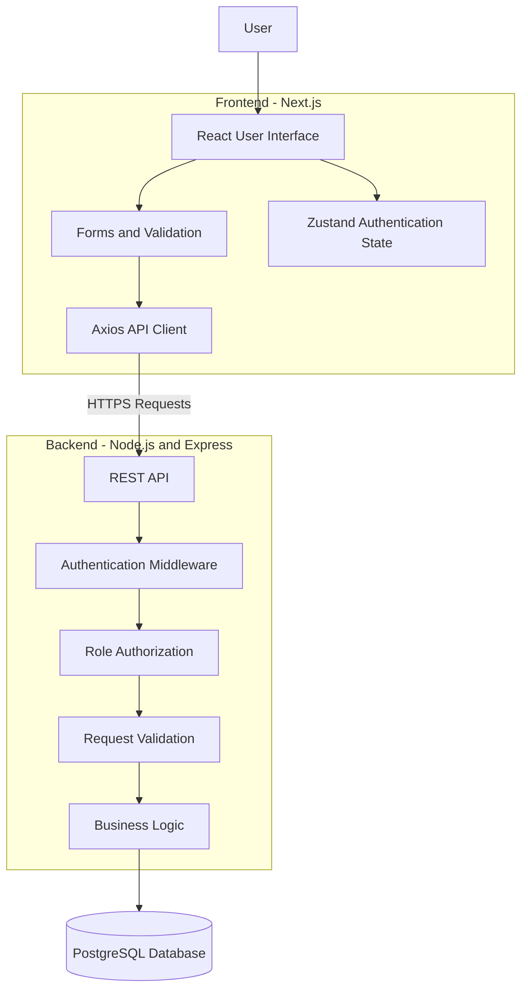
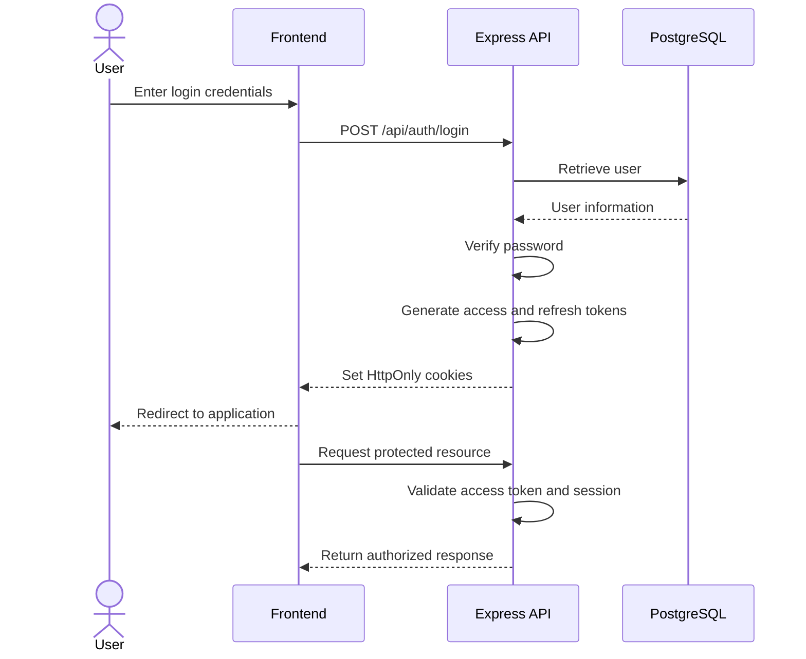
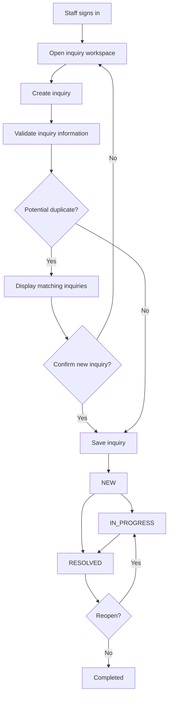
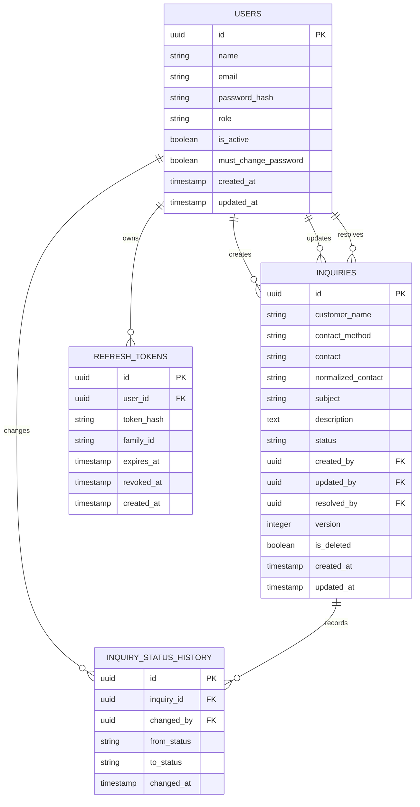
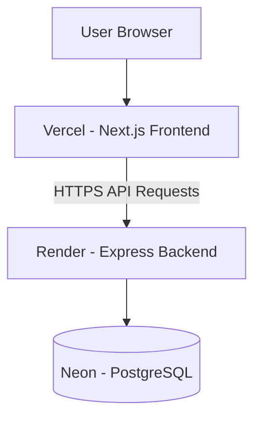

# Customer Inquiry Management System

\<p align="center">
&#x20; \<strong>A secure, full-stack platform for managing customer inquiries and support workflows.\</strong>
\</p>

\<p align="center">
&#x20; \<a href="[https://customer-inquiry-management-system-alpha.vercel.app/](https://customer-inquiry-management-system-alpha.vercel.app/)">Live Application\</a> ·
&#x20; \<a href="[https://customer-inquiry-management-system-mqze.onrender.com/api-docs](https://customer-inquiry-management-system-mqze.onrender.com/api-docs)">API Documentation\</a> ·
&#x20; \<a href="docs/ERD.md">Database ER Diagram\</a> ·
&#x20; \<a href="DECISIONS.md">Design Decisions\</a>
\</p>

\<p align="center">
&#x20; \
&#x20; \
&#x20; \
&#x20; \
&#x20; \
&#x20; \
&#x20; \
\</p>

---

## Overview

The **Customer Inquiry Management System** is a full-stack web application designed to help customer service teams record, organize, track, and manage customer inquiries through a centralized workspace.

The system provides secure authentication, role-based access control, inquiry lifecycle management, duplicate detection, audit history, and staff administration.

It follows a separated frontend and backend architecture, with a Next.js application communicating with a REST API built using Node.js and Express. PostgreSQL is used for persistent data storage.

## Live Application

| Component       | URL                                                                                                     |
| --------------- | ------------------------------------------------------------------------------------------------------- |
| Frontend        | [Open Application](https://customer-inquiry-management-system-alpha.vercel.app/)                        |
| Backend API     | [Open API](https://customer-inquiry-management-system-mqze.onrender.com/api)                            |
| Swagger UI      | [Explore API Documentation](https://customer-inquiry-management-system-mqze.onrender.com/api-docs)      |
| API Health      | [Check Backend Health](https://customer-inquiry-management-system-mqze.onrender.com/api/health)         |
| Database Health | [Check Database Connection](https://customer-inquiry-management-system-mqze.onrender.com/api/health/db) |

---

## Features

### Authentication and Security

- Secure user authentication.
- JWT-based access authentication.
- Access tokens stored in HttpOnly cookies.
- Refresh token rotation and session management.
- Password hashing using bcrypt.
- Protected frontend routes.
- Backend-enforced authentication and authorization.
- Forced password change support.
- Session invalidation for deactivated users.

### Inquiry Management

- Create and manage customer inquiries.
- View inquiry details.
- Search and filter inquiries.
- Paginated inquiry listing.
- Update inquiry statuses.
- Reopen resolved inquiries.
- Potential duplicate inquiry detection.
- Duplicate confirmation workflow.
- Inquiry status history.
- Soft deletion with administrator authorization.
- Optimistic concurrency control to prevent stale updates.

### Staff Management

- ADMIN and STAFF roles.
- Create and update staff accounts.
- Activate and deactivate staff accounts.
- Reset staff passwords.
- Administrator-only staff management.
- Session revocation when staff accounts are deactivated or passwords are reset.

### Data Integrity

- Frontend and backend validation.
- Controlled inquiry status transitions.
- Normalized contact information for duplicate detection.
- HTTP 409 conflict responses for conflicting or outdated operations.
- Audit information for important inquiry actions.
- Parameterized database queries.

---

## Technology Stack

| Category             | Technologies                  |
| -------------------- | ----------------------------- |
| Frontend Framework   | Next.js                       |
| UI Library           | React                         |
| Programming Language | TypeScript                    |
| Styling              | Tailwind CSS                  |
| Authentication State | Zustand                       |
| HTTP Client          | Axios                         |
| Form Management      | React Hook Form               |
| Form Validation      | Zod                           |
| Icons                | Lucide React                  |
| Backend Runtime      | Node.js                       |
| Backend Framework    | Express.js                    |
| Database             | PostgreSQL                    |
| Password Hashing     | bcrypt                        |
| Authentication       | JWT                           |
| API Documentation    | Swagger / OpenAPI             |
| Frontend Testing     | Vitest, React Testing Library |
| Backend Testing      | Vitest, Supertest             |
| Frontend Hosting     | Vercel                        |
| Backend Hosting      | Render                        |
| Database Hosting     | Neon                          |
| Version Control      | Git and GitHub                |

---

## System Architecture

The application uses a separated frontend and backend architecture.



### Authentication Flow



### Inquiry Workflow



---

## Database Design

The application uses PostgreSQL to store user accounts, inquiries, authentication sessions, and inquiry status history.

### Entity Relationship Diagram

The following diagram shows the main database entities and their conceptual relationships.



**Note:** This is a conceptual relationship diagram showing the main entities and their responsibilities. Refer to the actual SQL migration files for the exact column definitions, constraints, indexes, and foreign-key rules.

### Entity Responsibilities

| Entity                   | Responsibility                                                                 |
| ------------------------ | ------------------------------------------------------------------------------ |
| `users`                  | Stores administrator and staff account information.                            |
| `inquiries`              | Stores customer inquiry details, status, audit references, and deletion state. |
| `refresh_tokens`         | Stores hashed refresh tokens and session lifecycle information.                |
| `inquiry_status_history` | Records inquiry status changes and the user responsible for each change.       |

For the standalone diagram, see [docs/ERD.md](docs/ERD.md).

---

## User Roles and Permissions

The system supports two user roles.

| Feature                       | ADMIN | STAFF |
| ----------------------------- | :---: | :---: |
| Sign in                       |   ✓   |   ✓   |
| View inquiries                |   ✓   |   ✓   |
| Create inquiries              |   ✓   |   ✓   |
| Search and filter inquiries   |   ✓   |   ✓   |
| View inquiry details          |   ✓   |   ✓   |
| Update inquiry status         |   ✓   |   ✓   |
| View inquiry history          |   ✓   |   ✓   |
| Soft-delete inquiries         |   ✓   |   —   |
| View staff directory          |   ✓   |   —   |
| Create and update staff       |   ✓   |   —   |
| Activate and deactivate staff |   ✓   |   —   |
| Reset staff passwords         |   ✓   |   —   |

All permissions are enforced by the backend. Frontend route protection is not treated as a security boundary.

---

## Inquiry Lifecycle

The application uses three inquiry statuses:

| Status        | Description                      |
| ------------- | -------------------------------- |
| `NEW`         | Newly recorded inquiry.          |
| `IN_PROGRESS` | Inquiry currently being handled. |
| `RESOLVED`    | Inquiry that has been resolved.  |

### Allowed Transitions

| Current Status | Next Status |  Allowed |
| -------------- | ----------- | :------: |
| NEW            | IN_PROGRESS |     ✓    |
| NEW            | RESOLVED    |     ✓    |
| IN_PROGRESS    | RESOLVED    |     ✓    |
| IN_PROGRESS    | NEW         |     ✗    |
| RESOLVED       | IN_PROGRESS | ✓ Reopen |
| RESOLVED       | NEW         |     ✗    |

Invalid transitions are rejected by the backend.

---

## Security and Data Integrity

### Authentication

- Access tokens are stored in HttpOnly cookies.
- Refresh tokens are rotated.
- Refresh token hashes are stored in PostgreSQL.
- Passwords are hashed using bcrypt.
- Protected API endpoints require authentication.
- Staff management and inquiry deletion require administrator authorization.

### Duplicate Detection

Potential duplicates are identified using normalized contact information.

When a potential duplicate is detected:

1. The application displays matching active inquiries.
2. The user can review the matches.
3. The user can confirm whether the new inquiry represents a separate issue.
4. The backend independently checks the duplicate condition before creating the inquiry.

### Optimistic Concurrency

The inquiry version field helps detect outdated updates.

When an update is made using an old version, the backend returns HTTP `409 Conflict` rather than silently overwriting a more recent change.

### Soft Deletion

Inquiries are soft-deleted instead of being permanently removed. This preserves historical records and audit information.

---

## Project Structure

```text
customer-inquiry-management-system/
│
├── backend/
│   ├── src/
│   │   ├── config/
│   │   ├── controllers/
│   │   ├── db/
│   │   ├── middleware/
│   │   ├── routes/
│   │   ├── services/
│   │   ├── types/
│   │   ├── utils/
│   │   ├── validators/
│   │   ├── app.ts
│   │   └── server.ts
│   │
│   ├── migrations/
│   ├── tests/
│   ├── .env.example
│   ├── package.json
│   └── TESTING.md
│
├── frontend/
│   ├── src/
│   │   ├── app/
│   │   ├── components/
│   │   ├── features/
│   │   ├── hooks/
│   │   ├── lib/
│   │   ├── stores/
│   │   └── tests/
│   │
│   ├── public/
│   ├── package.json
│   └── vitest.config.ts
│
├── docs/
│   └── ERD.md
│
├── .github/
│   └── workflows/
│
├── .gitignore
├── LICENSE
├── README.md
├── DECISIONS.md
└── CONTRIBUTING.md
```

The directory tree is a high-level overview. Keep it updated if the actual repository structure changes.

---

# Local Development Setup

Follow these instructions to run the application locally on Windows, macOS, or Linux.

## Prerequisites

Install the following:

- [Node.js](https://nodejs.org/)
- npm (included with Node.js)
- [Git](https://git-scm.com/)
- PostgreSQL database access (local PostgreSQL or a dedicated Neon test database)
- VS Code or another code editor

## 1. Clone the Repository

Open PowerShell or a terminal:

```bash
git clone https://github.com/dinithanki/customer-inquiry-management-system.git

cd customer-inquiry-management-system
```

## 2. Backend Installation

Navigate to the backend:

```bash
cd backend
```

Install dependencies:

```bash
npm install
```

## 3. Configure Backend Environment Variables

Create a `.env` file inside the `backend/` directory.

Use `backend/.env.example` as the reference if it is present.

Configure the required values:

```env
PORT=5000

FRONTEND_ORIGIN=http://localhost:3000

DATABASE_URL=YOUR_PRODUCTION_DATABASE_CONNECTION_STRING
DATABASE_URL_TEST=YOUR_TEST_DATABASE_CONNECTION_STRING

INITIAL_ADMIN_NAME=System Administrator
INITIAL_ADMIN_EMAIL=admin@example.com
INITIAL_ADMIN_PASSWORD=YOUR_STRONG_INITIAL_ADMIN_PASSWORD

JWT_ACCESS_SECRET=YOUR_LONG_RANDOM_SECRET
ACCESS_TOKEN_EXPIRES_IN=15m
REFRESH_TOKEN_EXPIRES_IN=7d
```

Replace the example values with your own configuration.

**Important:**

- `DATABASE_URL` is the normal application database connection.
- `DATABASE_URL_TEST` is the separate test/development database connection.
- Never commit your `.env` file.
- Never publish database passwords, JWT secrets, or administrator passwords.
- Keep your development database separate from production.

Use the exact variable names required by the backend configuration.

## 4. Select the Development/Test Database

The backend chooses its database connection based on `NODE_ENV`.

| Environment              | Database            |
| ------------------------ | ------------------- |
| `NODE_ENV=test`          | `DATABASE_URL_TEST` |
| `NODE_ENV` is not `test` | `DATABASE_URL`      |

For local development, select the test database.

In PowerShell, from the `backend/` directory:

```powershell
$env:NODE_ENV = "test"
```

This setting applies to the current PowerShell terminal session.

Keep this terminal in test mode while running the local migration, seed, and backend commands below.

## 5. Run Database Migrations

Make sure your test database is available and that `DATABASE_URL_TEST` points to it.

Run:

```bash
npm run db:migrate
```

This applies the database migrations required by the application.

Wait for the command to finish successfully before continuing.

## 6. Create the Initial ADMIN Account

The application uses an initial administrator seed script.

Before running it, check that the following environment variables are configured in `backend/.env`:

```env
INITIAL_ADMIN_NAME=System Administrator
INITIAL_ADMIN_EMAIL=admin@example.com
INITIAL_ADMIN_PASSWORD=YOUR_STRONG_INITIAL_ADMIN_PASSWORD
```

Run the seed command:

```bash
npm run db:seed:admin
```

The seed script uses the configured initial administrator details to bootstrap the administrator account.

Use the email and password you configured when signing in locally. If the seed script reports that an administrator already exists, follow the message rather than trying to insert another administrator manually.

**Security:** Do not put your actual administrator password in this README or commit it to GitHub.

## 7. Start the Backend Server

Keep `NODE_ENV=test` in the same PowerShell terminal.

Run:

```bash
npm run dev
```

The backend should be available at:

```text
http://localhost:5000
```

Check the health endpoint:

```text
http://localhost:5000/api/health
```

Open Swagger documentation:

```text
http://localhost:5000/api-docs
```

Keep this terminal running.

## 8. Frontend Installation

Open a second terminal.

From the repository root:

```bash
cd frontend
```

Install frontend dependencies:

```bash
npm install
```

Create a `.env.local` file inside `frontend/`:

```env
NEXT_PUBLIC_API_URL=http://localhost:5000/api
```

## 9. Start the Frontend

Run:

```bash
npm run dev
```

Open the application:

```text
http://localhost:3000
```

Sign in using the administrator email and password configured in the backend seed environment variables.

You can now use the application locally.

### Local Development Summary

You should have two running terminals:

| Terminal   | Directory   | Command                            |
| ---------- | ----------- | ---------------------------------- |
| Terminal 1 | `backend/`  | `NODE_ENV=test` then `npm run dev` |
| Terminal 2 | `frontend/` | `npm run dev`                      |

The frontend communicates with the backend through the local API URL.

**Database safety:** Do not remove the `NODE_ENV=test` override before running local migrations or the seed command. In this project's configuration, the normal non-test mode selects `DATABASE_URL`, which is intended for production.

---

## API Documentation

The backend provides REST API endpoints for authentication, staff management, and inquiry management.

### Swagger UI

- Local: `http://localhost:5000/api-docs`
- Production: [Open Swagger Documentation](https://customer-inquiry-management-system-mqze.onrender.com/api-docs)

### Main API Groups

| API Group        | Description                           |
| ---------------- | ------------------------------------- |
| `/api/auth`      | Authentication and session management |
| `/api/users`     | Staff and user management             |
| `/api/inquiries` | Inquiry operations                    |
| `/api/health`    | Backend health check                  |
| `/api/health/db` | Database connectivity check           |

Use Swagger UI to explore the available endpoints, request parameters, responses, and authentication requirements.

---

## Testing

The project includes automated backend and frontend tests.

### Backend Tests

The backend test suite contains **86 automated tests across 12 test files**.

From `backend/`:

```bash
npm test
```

Run type checking:

```bash
npm run typecheck
```

Build the backend:

```bash
npm run build
```

### Frontend Tests

The frontend test suite contains **6 automated tests across 3 test files**.

From `frontend/`:

```bash
npm test
```

Run lint checks:

```bash
npm run lint
```

Run TypeScript checks:

```bash
npx tsc --noEmit
```

Build the frontend:

```bash
npm run build
```

### Testing Coverage

The test suites cover areas including:

- Authentication and authorization.
- Backend request validation.
- Inquiry business rules.
- API behavior.
- Authentication state management.
- Inquiry form validation.
- Inquiry form interactions.

See [backend/TESTING.md](backend/TESTING.md) for backend testing details.

Automated tests do not replace full manual verification of the deployed frontend, backend, and database working together.

---

## Deployment Architecture

The application is deployed using separate frontend and backend hosting services.



### Frontend - Vercel

- Hosting platform: Vercel
- Root directory: `frontend`
- Framework: Next.js

Production environment variable:

```env
NEXT_PUBLIC_API_URL=https://customer-inquiry-management-system-mqze.onrender.com/api
```

### Backend - Render

- Hosting platform: Render
- Root directory: `backend`
- Build command: `npm install && npm run build`
- Start command: `npm start`

Configure the required production environment variables in the Render dashboard, including:

- `NODE_ENV=production`
- `DATABASE_URL`
- `JWT_ACCESS_SECRET`
- `FRONTEND_ORIGIN`
- `BACKEND_URL`
- Initial administrator variables when needed for the seed process

Render supplies the `PORT` variable.

Before serving production traffic, ensure that migrations have been applied to the production database and the initial administrator account exists.

Never use your test database for production data.

---

## Additional Documentation

| Document                                 | Description                                                        |
| ---------------------------------------- | ------------------------------------------------------------------ |
| [ERD.md](docs/ERD.md)                    | Database entity relationship diagram                               |
| [DECISIONS.md](DECISIONS.md)             | Assumptions, design decisions, trade-offs, and future improvements |
| [CONTRIBUTING.md](CONTRIBUTING.md)       | Contribution guidelines                                            |
| [LICENSE](LICENSE)                       | MIT License                                                        |
| [Backend TESTING.md](backend/TESTING.md) | Backend testing instructions                                       |

---

## Future Improvements

Potential future enhancements include:

- Real-time inquiry updates across multiple sessions.
- Expanded end-to-end and integration testing.
- Improved application logging and monitoring.
- Inquiry analytics and reporting.
- Further accessibility improvements.

---

## Contributing

Contributions, bug reports, and suggestions are welcome.

Please read the [Contributing Guide](CONTRIBUTING.md) before submitting changes.

---

## License

This project is licensed under the MIT License.

See the [LICENSE](LICENSE) file for the complete license text.

---

## Author

**Dinith Pamunuwatte**

- GitHub: [@dinithanki](https://github.com/dinithanki)
- Portfolio: [dinith-pamunuwatte.vercel.app](https://dinith-pamunuwatte.vercel.app/)

---

\<p align="center">   \<strong>Customer Inquiry Management System\</strong>   \<br />   Built with Next.js, TypeScript, Node.js, Express.js, and PostgreSQL. \</p>
