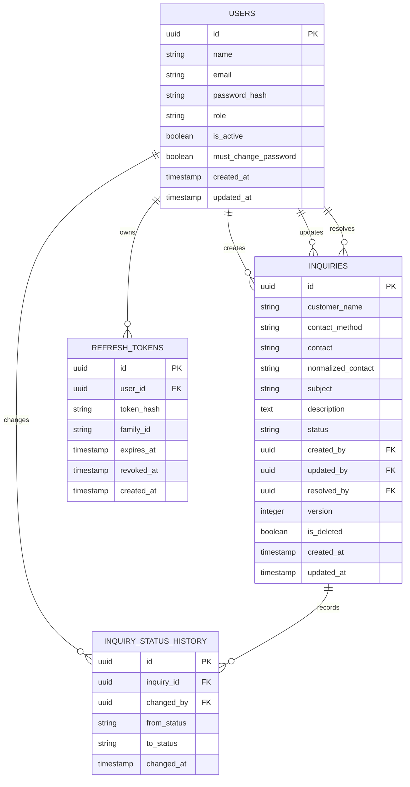

# Database Entity Relationship Diagram

## Customer Inquiry Management System

This document describes the main database entities and their conceptual relationships.

The application uses PostgreSQL to manage user accounts, customer inquiries, refresh-token sessions, and inquiry status history.

## Entity Relationship Diagram

## Entity Descriptions

### 1. USERS

Stores application user accounts.

Responsibilities:

- Stores administrator and staff account details.
- Identifies user roles.
- Stores password hashes.
- Tracks account activation.
- Tracks whether a password change is required.

### 2. INQUIRIES

Stores customer inquiry information.

Responsibilities:

- Stores customer contact information.
- Stores inquiry subject and description.
- Tracks the inquiry lifecycle status.
- Records the staff members responsible for creating, updating, and resolving inquiries.
- Uses a version field for optimistic concurrency.
- Supports soft deletion.

### 3. REFRESH_TOKENS

Stores refresh-token session information.

Responsibilities:

- Associates refresh-token records with users.
- Stores token hashes instead of raw refresh tokens.
- Supports token expiration.
- Supports token rotation and revocation.
- Groups related refresh tokens using a token family identifier.

### 4. INQUIRY_STATUS_HISTORY

Records inquiry status changes.

Responsibilities:

- Associates history records with inquiries.
- Identifies the user who changed the status.
- Stores the previous status.
- Stores the new status.
- Records when the change occurred.

## Relationship Summary

| Relationship | Description |
|---|---|
| USERS → INQUIRIES | A user can create multiple inquiries. |
| USERS → INQUIRIES | A user can update multiple inquiries. |
| USERS → INQUIRIES | A user can resolve multiple inquiries. |
| USERS → REFRESH_TOKENS | A user can have multiple refresh-token records over time. |
| USERS → INQUIRY_STATUS_HISTORY | A user can make multiple inquiry status changes. |
| INQUIRIES → INQUIRY_STATUS_HISTORY | An inquiry can have multiple status history records. |

## Important Note

This is a conceptual ER diagram for understanding the database design. The actual migration files in `backend/migrations/` are the source of truth for exact column definitions, constraints, indexes, nullability, and foreign-key behavior.

Check the migration files whenever the database schema changes.